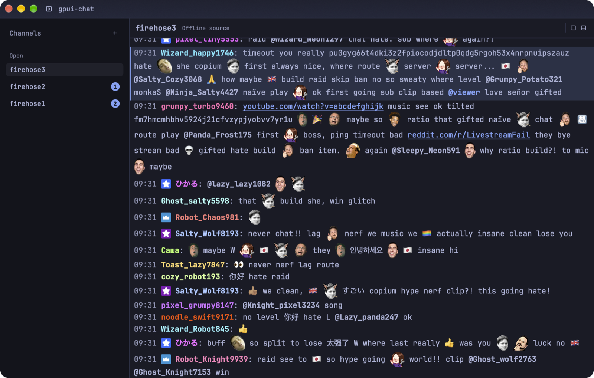
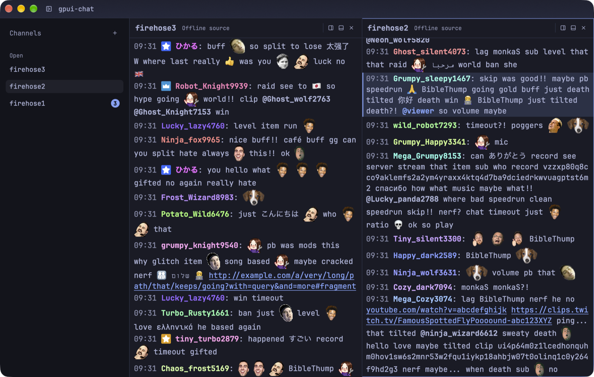
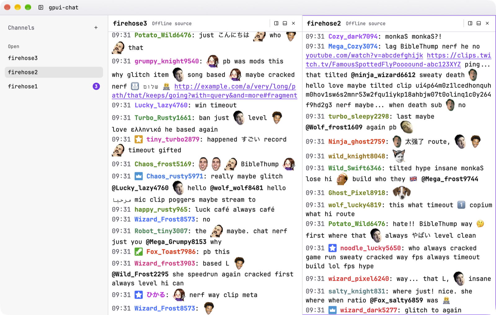
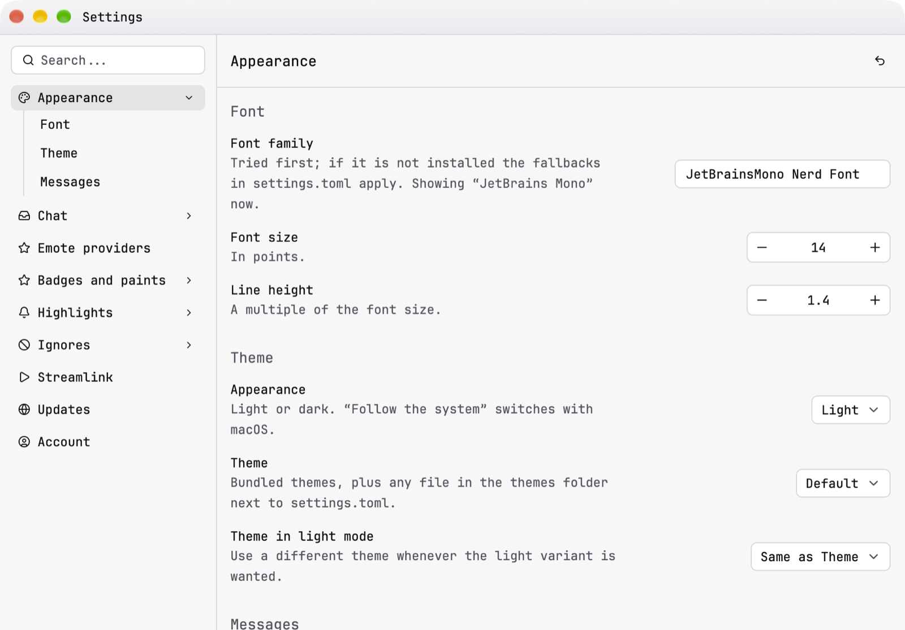
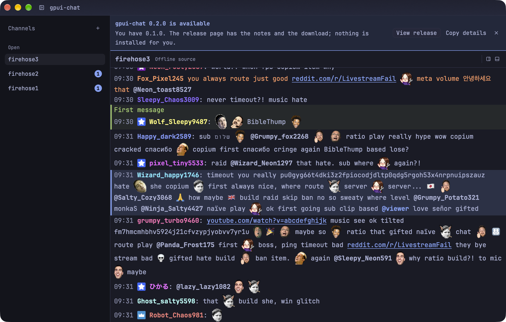

# gpui-chat

A native, fast Twitch chat client for the desktop, in the spirit of [Chatterino](https://chatterino.com),
written in Rust on [GPUI](https://www.gpui.rs) via [GPUI Kit](https://crates.io/crates/gpui-kit). Read any
chat without logging in, split the window into as many channels as you like, and keep it smooth at
a thousand messages a second.



> **Status: pre-release.** The app is feature complete for macOS, but no release is published yet (the first one
> will be v0.1.0). Linux and Windows builds are planned. Until there is a release, [build it from
> source](#build-from-source).

<table>
  <tr>
    <td></td>
    <td></td>
  </tr>
  <tr>
    <td></td>
    <td></td>
  </tr>
</table>

*(Screenshots use the offline synthetic chat, `--firehose`: the names and messages are made up.)*

## Features

- **Chat without an account.** Anonymous, read-only chat works out of the box; log in (Twitch device code flow,
  no password in the app, token in the macOS keychain) to send messages and reply.
- **Channels and splits.** A collapsible sidebar of open channels with unread and mention markers; split panes
  side by side or stacked, drag channels and panes around, saved between launches.
- **Emotes and badges.** Twitch, 7TV (animated and zero-width included), BetterTTV and FrankerFaceZ emotes with
  live set updates, an emote picker and `:emote` / `@name` / `/command` completion; Twitch, 7TV, FFZ and
  Chatterino badges and 7TV name paints. Each provider has a switch.
- **Mentions and highlights.** Highlight your name, phrases, regular expressions and users, a Mentions panel,
  unread counts and rate-limited system notifications.
- **Find, filter, ignore.** In-channel search with `from:` filters, ignore users and phrases, optional sync of
  your Twitch block list.
- **Moderation** for channels you moderate, behind opt-in permissions: timeouts, bans, deletes, room modes and
  slash commands.
- **Streamlink.** A play button per channel that launches [streamlink](https://streamlink.github.io) in your
  player, with a quality menu.
- **Yours to change.** A settings window over a plain `settings.toml`, a `keymap.toml` and a command palette, 20+
  bundled colour themes plus your own, JetBrains Mono bundled (or the font you choose).
- **Fast.** A custom virtualised chat view with enforced performance budgets for scrolling, bursts, idle CPU,
  memory and launch (`scripts/bench.sh`).
- **Quiet about the network.** It talks to Twitch; the emote providers you leave on (7TV, BetterTTV,
  FrankerFaceZ); the badge and cosmetics providers you leave on (7TV, FrankerFaceZ, Chatterino); a
  recent-messages service (switchable); and, once a day, GitHub's release list for an update notice
  (switchable, never downloads anything). The [guide](docs/GUIDE.md) and [`docs/SETTINGS.md`](docs/SETTINGS.md) say exactly what is sent.

## Install

macOS 12 or later, Apple Silicon or Intel.

**DMG.** Download `gpui-chat-<version>-macos-universal.dmg` from the
[Releases](https://github.com/charlie-niekirk/gpui-chat/releases) page, open it and drag the app to
*Applications*.

**Homebrew.** Once the first release is out and the tap exists:

```bash
brew install --cask charlie-niekirk/tap/gpui-chat
```

(The cask template and the release steps are in [`docs/RELEASING.md`](docs/RELEASING.md).)

**Gatekeeper.** Releases are signed ad hoc until a Developer ID certificate is set up, so macOS says the app is
from an unidentified developer. Right-click the app in *Applications* → *Open* → *Open* once (on macOS 15 and
later: try to open it, then *System Settings → Privacy & Security → Open Anyway*), or remove the quarantine
flag:

```bash
xattr -dr com.apple.quarantine /Applications/gpui-chat.app
```

The app checks GitHub for a newer release once a day and tells you with a notice; it never installs anything
itself (*Settings → Updates* turns the check off).

## Using it

Press **⌘N**, type a channel name and press Enter: chat starts at once. The **[user guide](docs/GUIDE.md)** covers
channels and splits, logging in and what each permission is for, emotes, highlights, moderation, streamlink, the
keyboard shortcuts, where the files live and troubleshooting.

## Build from source

Requires macOS and a Rust toolchain (the version is pinned in [`rust-toolchain.toml`](rust-toolchain.toml)).

```bash
cargo run -p gpui-chat                                       # launch the app
cargo run -p gpui-chat --release -- --firehose 1000 --hud    # offline synthetic chat at 1000 msgs/s, debug HUD (⌘⇧D)
cargo run -p gpui-chat -- --help                             # all developer flags
scripts/bundle-macos.sh --arch native                        # the .app and a DMG in dist/ (docs/RELEASING.md)
cargo test --workspace                                       # tests (everything but the GPUI app also runs on Linux in CI)
```

Developer flags (offline, no network or login needed):

| Flag | Meaning |
|---|---|
| `--firehose <msgs/sec>` | Feed the app deterministic synthetic chat at a steady rate |
| `--seed <n>` | Seed of the synthetic chat (default is fixed, so runs repeat) |
| `--firehose-channels <n>` | Spread the synthetic chat over `n` channels (default 1) |
| `--replay <file>` | Replay a recorded raw IRC log (e.g. `fixtures/irc/privmsg.irc`) through the real parser |
| `--replay-speed <x>` | `1` follows the log's `tmi-sent-ts` spacing (100 msgs/s if it has none), `2` is twice as fast, `0` is as fast as possible (default `1`) |
| `--hud` | Start with the debug HUD visible |

The debug HUD (frame time and ingest apply time against the 8.3 ms budget, messages/sec, batch size, store
sizes, dropped events, replay parse errors) toggles with ⌘⇧D or View → Toggle Debug HUD.

## Project layout and contributing

See [`docs/ARCHITECTURE.md`](docs/ARCHITECTURE.md) for how the crates fit together, [`docs/RELEASING.md`](docs/RELEASING.md)
for cutting a release, and [`PLAN.md`](PLAN.md) for the roadmap. Contributor and AI-agent conventions are in
[`CONTRIBUTING.md`](CONTRIBUTING.md) and [`CLAUDE.md`](CLAUDE.md).

## License

[MIT](LICENSE). The bundled JetBrains Mono is under the SIL Open Font License (`assets/fonts/OFL.txt`); the bundled
themes' sources are in `assets/themes/NOTICES.md`.
